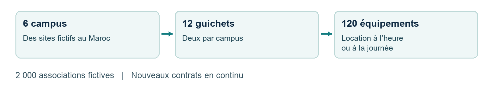
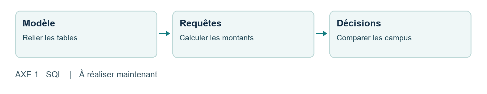
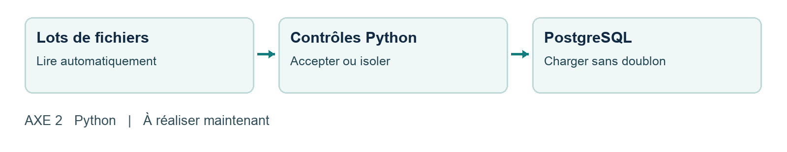
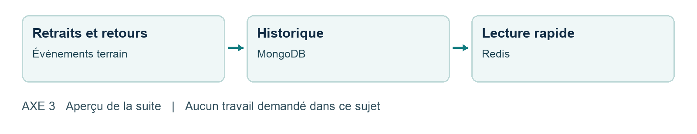
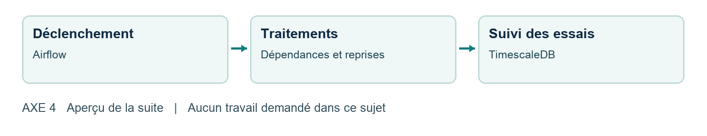
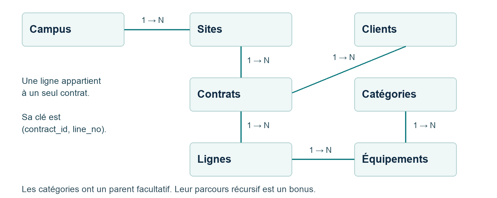
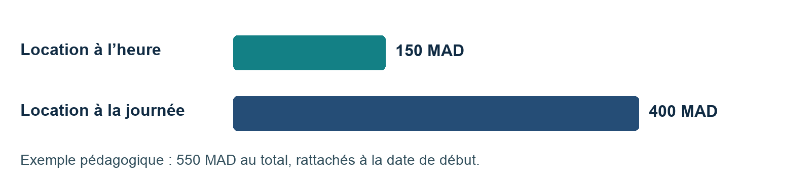
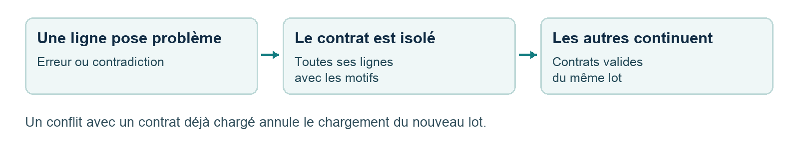
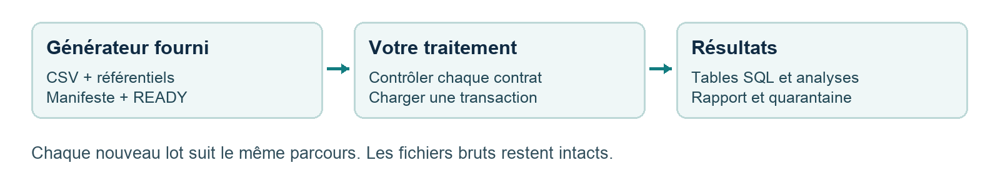

# CampusEquip

Sujet étudiant des axes 1 et 2
Lancement le 29 octobre 2026 · Remise le 21 novembre 2026

Vous devez construire, en binôme, un pipeline qui transforme des fichiers de locations en données fiables et en indicateurs SQL. CampusEquip loue du matériel à des associations sur plusieurs campus. Chaque campus possède deux guichets. Une association peut louer plusieurs équipements, à l’heure ou à la journée.



## Les questions auxquelles votre équipe doit répondre

Quel montant chaque campus réalise-t-il chaque jour ? Quels équipements rapportent le plus ? Les locations à l’heure et à la journée contribuent-elles de la même façon ? Quels contrats doivent être isolés parce que leurs données sont incohérentes ? Un fichier déjà traité peut-il être reçu à nouveau sans doubler les montants ?

## Le résultat attendu

Vous devez relier les tables avec SQL, appliquer les règles de qualité avec Python et charger les contrats acceptés dans PostgreSQL. Une fois votre traitement complété, la boucle fournie doit prendre en charge les nouveaux lots sans intervention manuelle. Vous devez expliquer les résultats à partir de preuves simples.

Ce sujet fixe le travail des deux premiers axes. Le socle vaut 10 points ; les extensions permettent de gagner 5 points bonus. Les axes 3 et 4 sont présentés pour comprendre la destination du projet, sans travail à réaliser à ce stade.

# Les quatre étapes du projet

Vous devez d’abord réussir le trajet SQL et Python. Les images suivantes montrent le rôle de chaque axe. Les deux dernières étapes seront traitées dans des consignes distinctes ; elles ne modifient pas les règles ni les livrables de ce sujet.









Le cadre global du projet est de 20 points de socle et de 10 points bonus, soit un maximum de 30/20. Cette première moitié représente 10 points de socle et 5 points bonus, soit un maximum de 15/10.

# Comprendre les sources et les relations

Vous devez partir du kit CampusEquip v2 joint à ce sujet. Un lot regroupe des contrats nouveaux et complets. Une ligne CSV décrit un équipement loué dans un contrat. Le même contrat peut donc occuper plusieurs lignes. Un site appartient à un seul campus.



| Fichier du lot | Ce qu’il représente |
| --- | --- |
| locations.csv | Les lignes des nouveaux contrats de ce lot. |
| referentiels.json | Les campus, sites, clients, catégories et équipements autorisés. |
| manifest.json | La version du format, la campagne, le numéro du lot et les empreintes des deux sources. |
| READY | Le marqueur indiquant que le lot complet peut être lu. |

Vous devez conserver les sources brutes. Le générateur publie le dossier complet en une seule opération. Le surveilleur ignore les dossiers en cours d’écriture. Les référentiels sont fixes dans une campagne. Une nouvelle campagne doit utiliser un autre dossier et une base de démonstration neuve.

# Lire les colonnes sans ambiguïté

Vous devez accepter exactement les onze colonnes ci-dessous, dans cet ordre. Retirez les espaces périphériques et normalisez status et unit en minuscules. Vous ne devez inventer aucune valeur pour réparer une donnée invalide.

| Colonne | Exemple | Règle |
| --- | --- | --- |
| contract_id | 2001 | Entier strictement positif ; identité du contrat. |
| client_id | 12 | Identifiant présent dans les clients du référentiel. |
| site_id | 3 | Guichet connu ; il détermine le campus. |
| start_date | 2026-11-02 | Date ISO valide au format YYYY-MM-DD. |
| status | paid | paid, closed, draft ou cancelled. |
| line_no | 1 | Entier strictement positif, propre au contrat. |
| equipment_id | 8 | Identifiant présent dans les équipements. |
| quantity | 2 | Entier de 1 à 100 ; au-delà de 20, signalement. |
| unit | hour | hour ou day ; aucune autre unité. |
| duration | 3 | Entier de 1 à 720 heures ou de 1 à 365 jours. |
| unit_rate | 25.00 | Tarif en MAD, positif ou nul, au plus 2 décimales. |

## Ce qui doit rester identique dans un contrat

Vous devez vérifier que client_id, site_id, start_date et status sont identiques sur toutes les lignes d’un contrat après normalisation. La clé d’une ligne est le couple (contract_id, line_no). Les équipements, unités, durées et tarifs peuvent varier entre les lignes.

Les identifiants et les nombres entiers doivent contenir des chiffres uniquement après retrait des espaces. Pour le tarif, acceptez un point décimal et au plus deux chiffres après le point ; refusez les virgules, exposants, valeurs négatives et valeurs non finies. Vous devez utiliser Decimal en Python et NUMERIC en SQL.

# Calculer un montant compréhensible

Vous devez calculer chaque ligne avec la formule quantité × durée × tarif par unité. La durée est fournie et déjà exprimée dans l’unité de la ligne. Vous ne devez pas convertir les jours en heures ni déduire une durée à partir d’un retour de matériel.

| Contrat | Unité | Quantité | Durée | Tarif | Montant |
| --- | --- | --- | --- | --- | --- |
| 2001 / ligne 1 | hour | 2 | 3 | 25 MAD | 150 MAD |
| 2001 / ligne 2 | day | 1 | 2 | 200 MAD | 400 MAD |



Dans cet exemple, le contrat 2001 commence le 2 novembre et porte le statut paid. Vous devez donc retenir 550 MAD le 2 novembre. Ces deux lignes illustrent le calcul ; elles ne constituent pas le corrigé d’un lot du kit.

## Les conventions à respecter

Vous devez retenir les montants des contrats paid et closed. Les contrats draft et cancelled restent stockés s’ils sont valides, mais leur montant est exclu des indicateurs. Vous devez rattacher tout le montant à start_date et conserver le tarif historique reçu dans la ligne.

Vous pouvez comparer des montants en MAD entre les deux unités. Vous ne devez pas additionner directement des heures et des jours. Les taxes, cautions, retards, remboursements, disponibilités et transferts entre guichets sont hors périmètre. Ce calcul est une convention pédagogique, pas une règle comptable.

# Appliquer la cohérence et la quarantaine

Vous devez suivre le même raisonnement que dans le cours : contrôler la structure du fichier, normaliser, supprimer les répétitions exactes, puis vérifier les lignes et la cohérence du contrat. Vous devez garder la position source, les valeurs brutes et les motifs de chaque rejet.



| Situation | Décision et portée |
| --- | --- |
| Une répétition exacte après normalisation | Vous devez conserver une seule occurrence. |
| Même clé de ligne, mais contenu différent | Vous devez mettre tout le contrat en quarantaine. |
| Une ligne invalide ou un en-tête de contrat contradictoire | Vous devez mettre toutes les lignes de ce contrat en quarantaine. |
| quantity = 25, tous les autres contrôles réussis | Vous devez accepter la ligne et signaler une anomalie. |
| Colonnes absentes, supplémentaires ou dans le mauvais ordre | Vous devez rejeter le lot avant toute écriture métier. |
| Nouveau contenu avec un contrat déjà chargé | Vous devez annuler toute la transaction du nouveau lot. |

Vous devez calculer le taux de rejet sur les lignes après dédoublonnage, en incluant toutes les lignes mises en quarantaine. Si ce nombre de lignes est nul, le taux vaut 0. Au-delà de 20 %, vous devez produire une alerte ; les autres contrats valides peuvent quand même être chargés. Une anomalie seule ne compte pas comme un rejet.

# Axe 1 Modéliser et analyser avec SQL


Vous devez commencer avec un petit lot propre pour comprendre les relations. Créez une base de laboratoire distincte de ShopFlow. Vous pouvez réutiliser les exemples du cours et vous répartir le travail, mais chacun doit comprendre les clés et les jointures.

## Construire le modèle

Vous devez créer les tables des campus, sites, clients, catégories, équipements, contrats et lignes. Vous devez définir les clés primaires, les clés étrangères et les contraintes de quantité, durée, unité et tarif. Ajoutez un journal des lots pour préparer le rejeu de l’axe 2. Le schéma de la page 3 vous aide à distinguer les grains.

## Répondre à trois questions

| Analyse demandée | Résultat à expliquer |
| --- | --- |
| Montant par date et par campus | Du 1er au 21 novembre 2026, afficher les jours sans montant à zéro et le cumul par campus. |
| Équipements les plus contributeurs | Classer les équipements par montant décroissant dans chaque campus ; les égalités doivent avoir le même rang. |
| Location à l’heure ou à la journée | Comparer, par campus et par unité, le nombre de lignes retenues et leur montant. |

Vous devez produire un petit tableau de résultats pour chaque analyse et un graphique lisible pour au moins l’une d’elles. Vous pouvez utiliser un tableur ou Python. Vous devez indiquer les lots analysés et écrire deux phrases qui répondent à la question de départ.

Vous devez conserver les requêtes dans analyses.sql et prouver le calcul d’un contrat à la main. Les optimisations, le partitionnement et les analyses supplémentaires sont des bonus ; ils ne sont pas nécessaires pour obtenir les 10 points du socle.

# Axe 2 Contrôler et charger avec Python



Vous devez compléter etudiant/traitement.py. Le générateur et la boucle de surveillance sont fournis : vous n’avez pas à construire un orchestrateur. Réutilisez les fonctions du cours pour lire les CSV, normaliser les valeurs, contrôler les références et séparer les contrats acceptés des contrats rejetés.

## Charger une fois et pouvoir recommencer

Vous devez construire une signature à partir des empreintes SHA-256 de locations.csv et referentiels.json, puis de la version des règles campusequip-v2.0. Le même contenu avec les mêmes règles doit être reconnu même si le dossier est renommé. Le nom du fichier seul ne suffit pas.

Vous devez enregistrer les contrats acceptés et la signature du lot dans une même transaction PostgreSQL. Si cette signature est déjà présente, le résultat est DEJA_CHARGE et aucune donnée métier ne doit être ajoutée. Si un nouveau lot réutilise un contract_id déjà chargé, la transaction entière doit échouer. Vous ne devez pas écraser un contrat existant.

## Rendre le fonctionnement visible

Vous devez produire un rapport par tentative avec les lignes reçues, les doublons retirés, les lignes acceptées, les lignes rejetées, les contrats acceptés, les anomalies et le taux de rejet. Gardez la quarantaine et les motifs dans un fichier distinct. Vous devez renvoyer CHARGE, DEJA_CHARGE ou REJETE_STRUCTURE au surveilleur ; une erreur de chargement doit rester un échec visible.

Vous devez mémoriser la campagne autorisée dans votre laboratoire et refuser une autre campagne dans cette même base. Pour cette première moitié, un seul processus traite les lots, dans l’ordre. Aucune transaction entre plusieurs services, aucun cache et aucun DAG ne sont demandés.

# Faire circuler beaucoup de données

Vous devez démarrer par deux petits lots propres, puis utiliser le profil mixte. Le générateur n’exige aucune dépendance externe : Python 3.10 ou plus suffit. Le traitement étudiant utilise PostgreSQL et les bibliothèques Python du cours. Les commandes ci-dessous s’exécutent depuis la racine du kit.

```text
python generer.py --sortie essai --contrats 20 --lots 2 --profil propre --intervalle 0
```

Vous devez ensuite préparer une autre base de démonstration et un nouveau dossier de flux pour les essais plus volumineux. Le nombre indiqué est celui des contrats ; chaque contrat produit une à trois lignes, auxquelles le profil mixte ajoute certains cas de qualité.

```text
python generer.py --sortie flux --contrats 1000 --intervalle 10
```

Dans un second terminal, après avoir complété votre traitement et configuré la connexion à votre base, vous devez démarrer la surveillance.

```text
python surveiller.py --entree flux
```

Sans --lots, le générateur continue jusqu’à Ctrl+C. Le surveilleur attend les nouveaux dossiers publiés et traite les lots l’un après l’autre. Pour démontrer le fonctionnement continu, vous devez montrer au moins trois nouveaux lots pris en charge sans relancer votre traitement entre les lots.

## Les limites de la simulation

Vous devez arrêter les deux programmes après votre démonstration. Le générateur conserve tous les fichiers : il ne supprime rien pour libérer le disque. Le débit se règle avec --contrats et --intervalle. Les dates métier simulées vont du 1er au 21 novembre 2026 ; elles ne représentent pas l’heure réelle de génération.

Les identifiants continuent après un redémarrage dans le même dossier. Vous devez conserver generator-state.json et les paramètres initiaux. Une nouvelle campagne recommence ses identifiants et exige une base neuve. Cette simulation représente des arrivées continues de petits lots ; elle ne prétend pas reproduire un système distribué à grande échelle.

# Prouver que les règles fonctionnent

Vous devez préparer de petits fichiers de test dont vous pouvez expliquer chaque ligne. Écrivez le résultat attendu avant l’exécution, puis comparez-le au résultat observé. Utilisez les gros lots pour vérifier le fonctionnement continu, pas pour remplacer les tests de règles.

| Essai à réaliser | Preuve attendue |
| --- | --- |
| Location valide à l’heure et à la journée | Les deux montants sont exacts ; seuls paid et closed contribuent. |
| Répétition exacte et conflit de clé | La répétition compte une fois ; le conflit isole le contrat entier. |
| Quantité invalide et quantity = 25 | Le contrat invalide est isolé ; 25 produit une anomalie sans rejet. |
| Référence inconnue ou attribut de contrat contradictoire | Toutes les lignes du contrat concerné sont en quarantaine. |
| Structure incorrecte | Le lot est refusé avant toute écriture métier. |
| Rejeu après arrêt et redémarrage | Les identifiants, nombres de lignes et montants ne changent pas. |
| Nouveau lot réutilisant un contrat chargé | Aucun ajout partiel ; le journal du lot précédent reste intact. |
| Trois lots successifs pendant la surveillance | Trois rapports distincts prouvent le traitement automatique. |

Vous devez aussi montrer une alerte quand le taux de rejet dépasse 20 %, sans bloquer les contrats valides du lot. Le profil mixte sert à rencontrer des défauts, mais ne garantit pas à lui seul de franchir ce seuil : créez un petit cas ciblé.

Vous devez conserver les commandes, l’état initial, l’attendu et l’observé. Une capture peut aider, mais elle doit être accompagnée d’une explication. Vous ne devez pas annoncer comme testé un comportement que vous n’avez pas exécuté.

# Le barème et les extensions facultatives

Vous devez réussir le parcours simple avant d’ajouter des extensions. Le socle permet d’obtenir 10/10 sans IoT, API, Dask, index avancé ni interface graphique. Les bonus s’ajoutent au socle, dans la limite de 5 points.

| Socle des axes 1 et 2 | Points |
| --- | --- |
| Modèle relationnel et contraintes cohérentes | 2 |
| Trois analyses SQL, un tableau par analyse et un graphique | 2 |
| Contrôles Python, quarantaine et rapport de qualité | 2 |
| Chargement transactionnel, rejeu et prise en charge automatique | 2 |
| Preuves reproductibles et compréhension individuelle | 2 |
| Total du socle | 10 |

| Bonus au choix | Maximum |
| --- | --- |
| Comparer un plan SQL avant et après un index pertinent, sur le même volume et avec les mêmes résultats. | 1 |
| Ajouter une analyse récursive des catégories ou comparer un calcul à la demande avec un résultat précalculé. | 1 |
| Lire un lot volumineux par morceaux et prouver les mêmes décisions qu’en lecture complète, sans couper la cohérence des contrats. | 1 |
| Brancher une source IoT ou une API, simulée ou réelle, avec contrôles, rejeu et preuve de panne. | 2 |

Le bonus IoT ou API vaut 1 point pour l’acquisition et les contrôles, puis 1 point pour le rejeu et la panne. Pour chacun des trois autres bonus, une fonctionnalité sans preuve obtient au plus 0,5 point. Le critère de compréhension vaut 1 point commun pour les preuves et 1 point individuel pour expliquer ou modifier un cas simple.

Pour le bonus IoT, vous pouvez simuler un GPS attaché à un équipement : device_id, event_id, equipment_id, observed_at, latitude et longitude. Vous devez garder ces observations dans une table distincte des locations. Vous pouvez choisir à la place une API météo ou de disponibilité, avec une copie locale de test. Vous ne devez pas utiliser de position personnelle réelle.

# Organiser le travail et la remise

Vous devez remettre le travail des axes 1 et 2 au plus tard le 21 novembre 2026. Vous travaillez en binôme. Vous devez répartir les tâches, relire le travail de votre partenaire et être capable d’expliquer le parcours d’une location depuis le fichier jusqu’au résultat SQL.

| Étape | Production utile |
| --- | --- |
| Comprendre | Un schéma, un tableau des colonnes et un calcul de location expliqué. |
| Construire | Les tables, les trois analyses et le traitement Python complété. |
| Vérifier | Les petits tests de règles, le rejeu et trois lots traités automatiquement. |
| Expliquer | Un README, un rapport court et le journal des aides utilisées. |

Vous devez fournir les scripts SQL, le code Python, les tests, les paramètres de génération et les preuves. Votre README doit expliquer l’installation, la préparation d’une base neuve, la connexion sans secret personnel, le démarrage et l’arrêt. Vous devez garder un petit échantillon reproductible ; il n’est pas nécessaire de joindre tous les lots volumineux.

Vous devez limiter le rapport à quatre pages, hors annexes. Il doit montrer le modèle, un tableau de résultats, un graphique, une règle de quarantaine et une preuve de rejeu. Chaque membre doit pouvoir expliquer une jointure, une décision de qualité et le calcul d’un montant.

## Utiliser une aide sans perdre la compréhension

Vous pouvez utiliser les supports du cours et une IA pour comprendre ou déboguer. Vous devez noter les aides importantes dans journal_IA.md, vérifier le code obtenu et expliquer vos modifications. Une production que vous ne pouvez pas expliquer ne démontre pas l’acquisition de la compétence.

Vous devez garder une copie du sujet et du kit distribués. Les règles, le barème et les livrables de cette première moitié sont fixés dans cette version. Les consignes des axes 3 et 4 seront communiquées séparément ; aucune réalisation de ces axes n’est demandée ici.
